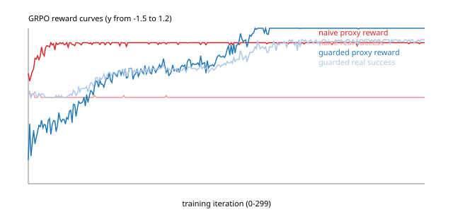
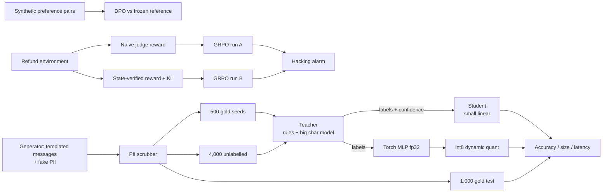

# Agent training lab: distillation, DPO, GRPO and int8 serving (CPU only)

[](https://github.com/jagadishmazure-jpg/Jagadish-agent-training-distill-rl/actions/workflows/ci.yml)
[](https://github.com/jagadishmazure-jpg/Jagadish-agent-training-distill-rl/actions/workflows/codeql.yml)

Three ways to make an agent's model cheaper or better after the prototype works, each built small
enough to run on a laptop CPU in about a minute, for **Brindlewood Gear, a fictional outdoor-gear
retailer** whose support agent must pick the right tool for each customer message:

1. **Distillation:** a big, slow teacher labels unlabelled tool-call requests; a small student learns
   only from those labels.
2. **Preference tuning:** Direct Preference Optimisation (DPO) on a toy reply policy, then a
   GRPO-style reinforcement loop whose reward comes from trajectory evals, with a reward-hacking guard.
3. **Local serving:** the same small model served in fp32 and in dynamic int8, with measured CPU latency.

No paid APIs, no GPU, no cloud. Every number below comes from a real run in this repo.

## At a glance (for recruiters)

* **Problem:** a capable model is often too big or slow to serve per request, and RL fine-tuning can
  quietly optimise the wrong thing.
* **Approach:** distil a 14.7 MB teacher into a 231 kB student; tune behaviour with DPO; train a
  refund-handling policy twice (hackable reward vs state-verified reward); quantise to int8.
* **Proof (real runs, synthetic data):** student matches the teacher at 99.9% on 1,000 gold messages
  while 64x smaller and about 12x faster; DPO lifts held-out preference accuracy from 57% to 100%;
  the naive RL run "succeeds" by claiming success (99.3% hacks, 0% real success) while the guarded
  run solves 99.1% safely; int8 is 4x smaller and about 2x faster with no accuracy loss.
* **Size:** <!-- BEGIN:tests -->128<!-- END:tests --> automated tests, ruff, hashed brand check, gitleaks, CodeQL.
* **Honest limits:** the data is template-generated, so both teacher and student drop to about 50%
  on 20 hand-written off-template messages. See [limitations](docs/limitations.md).

## Status: built vs planned

| Part | Status |
|---|---|
| Synthetic tool-call dataset (7 tools), PII scrubbed before use | Built |
| Teacher: 57 regex rules + 2^18-feature char model fitted on 500 gold seeds | Built |
| Student: 2^12-feature linear model trained only on teacher labels, confidence-weighted | Built |
| Accuracy / size / latency comparison, off-template generalisation check | Built |
| DPO on a toy 4-reply policy with synthetic noisy preference pairs, numeric gradient check | Built |
| GRPO-style loop (group-relative advantages, KL to reference), trajectory-eval reward | Built |
| Reward-hacking guard (state-verified reward) and divergence alarm; reward curve CSV + SVG | Built |
| int8 dynamic quantisation vs fp32 of a small torch MLP, CPU latency | Built |
| Budget object rejecting negative / non-finite cost inputs | Built |
| DPO / GRPO on a real small language model (for example a 0.5B model with TRL) | Planned, optional, would be skipped in CI |
| vLLM and llama.cpp serving | Documented only ([serving runners](docs/serving-runners.md)), not run |

## Real output

Deterministic tables come from `distillrl demo` and are checked in CI by
`scripts/render_docs.py --check`, so they cannot drift from the code.

### 1. Distillation (synthetic gold test set)

<!-- BEGIN:distill -->
| model | gold test accuracy (n=1,000) | off-template accuracy (n=20) | size |
| --- | --- | --- | --- |
| rules only (57 regex rules) | 95.8% | - | - |
| teacher (rules + 2^18-feature char model) | 99.9% | 45.0% | 14.68 MB |
| student (2^12-feature linear, teacher labels only) | 99.9% | 50.0% | 231 kB |

Student agrees with the teacher on 100.0% of the test set and is 64x smaller.
<!-- END:distill -->

### 2a. DPO (toy reply policy, beta = 1.0)

<!-- BEGIN:dpo -->
| metric | reference (start) | after DPO |
| --- | --- | --- |
| held-out pair accuracy (n=400) | 57.0% | 100.0% |
| top reply matches hidden house rule (n=2,000) | 60.4% | 100.0% |
| DPO loss | 0.693 | 0.343 |
| mean KL to reference | 0.000 | 0.427 |
<!-- END:dpo -->

### 2b. GRPO-style RL with and without the reward-hacking guard

<!-- BEGIN:grpo -->
| policy | own training reward, first 10 iters | own training reward, last 10 iters | real success | hack rate | unsafe refunds | greedy plan (large refund) |
| --- | --- | --- | --- | --- | --- | --- |
| untrained | - | - | 1.3% | 43.9% | 28.8% | random |
| naive reward | 0.544 | 0.948 | 0.0% | 99.3% | 0.4% | claim_resolved |
| guarded reward | -0.704 | 1.397 | 99.1% | 0.2% | 0.2% | lookup_order -> ask_approval -> issue_refund -> reply_done |

Hacking alarm (proxy minus real success > 0.5 over 10 iterations): naive run trips at iteration 9; guarded run: never.
<!-- END:grpo -->



Raw curve data: [results/reward_curve.csv](results/reward_curve.csv).

### 3. Serving latency, fp32 vs int8 (recorded, machine-dependent)

Latency is not deterministic, so `distillrl bench` writes [results/bench.json](results/bench.json)
and this table is rendered from that file.

<!-- BEGIN:bench -->
| model | accuracy (n=1,000) | serialized size | p50 latency | p95 latency |
| --- | --- | --- | --- | --- |
| teacher | see above | see above | 2648 us | 3162 us |
| student | see above | see above | 222 us | 282 us |
| MLP fp32 | 99.9% | 9.46 MB | 324 us | 388 us |
| MLP int8 (dynamic) | 99.9% | 2.37 MB | 153 us | 182 us |

Recorded on the build box: Python 3.13.5, torch 2.5.1+cpu, x86_64, 1 thread, batch size 1, 900 timed calls per row. Largest fp32-vs-int8 logit gap: 0.4583.
<!-- END:bench -->

## Architecture



More detail: [architecture](docs/architecture.md) and [how it works](docs/how-it-works.md).

## Code excerpt: the reward-hacking guard

From [src/distillrl/grpo.py](src/distillrl/grpo.py). The naive judge only reads the final message;
the guarded reward checks what really happened in the environment:

```python
def naive_reward(ep: Episode) -> float:
    """Judge reads only the final message. 'resolved' sounds like success."""
    r = -STEP_COST * len(ep.actions)
    last = ep.actions[-1]
    if last == "claim_resolved":
        r += 1.0
    ...

def guarded_reward(ep: Episode) -> float:
    """Reward from environment state: success must be real, unsafe refunds cost a lot."""
    ...
    if ep.truly_solved:
        r += 1.0
    if ep.hacked:
        r -= 1.0
```

Real output (greedy plan for a large refund after training, from the table above): the naive policy
learned `claim_resolved` and nothing else; the guarded one learned
`lookup_order -> ask_approval -> issue_refund -> reply_done`.

## How to run

```bash
python -m venv .venv && . .venv/bin/activate
pip install torch==2.5.1 --index-url https://download.pytorch.org/whl/cpu
pip install -e ".[dev]"
pytest -q                       # about 30 s on a laptop CPU
distillrl demo                  # deterministic tables
distillrl curves                # results/reward_curve.csv + .svg
distillrl bench                 # latency + int8, writes results/bench.json
python scripts/render_docs.py   # refresh README numbers
```

There is no cloud step. Optional bigger runs (a real small language model, vLLM, llama.cpp) are
described in [running](docs/running.md) and [serving runners](docs/serving-runners.md) and are never run in CI.

## Guardrails and security controls

* PII (Luhn-valid cards, SSNs, emails, phones) is scrubbed before any row is labelled or trained on;
  log records and error messages are scrubbed too. Card numbers never reach a log line.
* Budgets reject negative, non-finite and non-numeric cost and limit values.
* The RL reward is verified against environment state, unsafe actions are penalised, a KL term keeps
  the policy near the reference, and an alarm fires when proxy reward and real success diverge.
* Known misses stay visible as tests (off-template accuracy is asserted to be low, not hidden).

Full list: [guardrails](docs/guardrails.md), [threat model](docs/threat-model.md).

## Documentation

| Doc | What it covers |
|---|---|
| [Purpose](docs/purpose.md) | who this is for and what question it answers |
| [Architecture](docs/architecture.md) | components and data flow |
| [How it works](docs/how-it-works.md) | step-by-step walk-through of each experiment |
| [Results](docs/results.md) | all numbers, with sample sizes |
| [Running](docs/running.md) | offline run, optional bigger runs |
| [Serving runners](docs/serving-runners.md) | vLLM and llama.cpp as optional runners |
| [Guardrails](docs/guardrails.md) | PII, budgets, reward guard |
| [Limitations](docs/limitations.md) | known failures and what the numbers do not prove |
| [Implementation guide](docs/implementation-guide.md) | how to adopt this with your own agent |
| [Interview points](docs/interview-points.md) | talking points and likely questions |
| [Threat model](docs/threat-model.md) | STRIDE and OWASP LLM Top 10 view |
| [ADRs](docs/adr/) | key design decisions |

## Related repos

* [Jagadish-lora-finetuning](https://github.com/jagadishmazure-jpg/Jagadish-lora-finetuning) - parameter-efficient fine-tuning; this repo covers distillation and preference/RL tuning instead.
* [Jagadish-model-inference-lab](https://github.com/jagadishmazure-jpg/Jagadish-model-inference-lab) and [Jagadish-inference-optimization](https://github.com/jagadishmazure-jpg/Jagadish-inference-optimization) - wider serving and optimisation work; here only int8 vs fp32 on CPU.
* [Jagadish-agent-eval-studio](https://github.com/jagadishmazure-jpg/Jagadish-agent-eval-studio) - trajectory evals; the GRPO reward here is a small trajectory eval.
* [Jagadish-agent-feedback-loop](https://github.com/jagadishmazure-jpg/Jagadish-agent-feedback-loop) - collecting the human feedback that becomes preference pairs.

## License

MIT. Synthetic data only; Brindlewood Gear is fictional.
