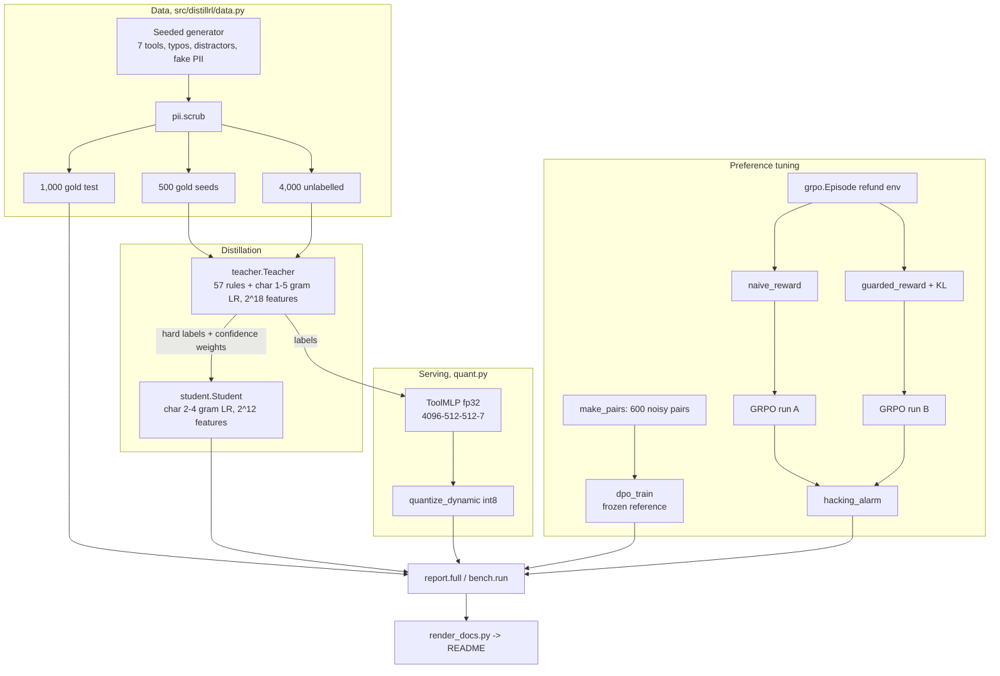

# Architecture

## Components

| Module | Role |
|---|---|
| `data.py` | seeded synthetic messages, gold tools, three disjoint splits, scrubbed |
| `pii.py` | card (Luhn), SSN, email and phone masking; logging filter; `SafeError` |
| `teacher.py` | rule scorer and the big char model, averaged 50/50 |
| `student.py` | distilled linear student, accuracy helper |
| `quant.py` | torch MLP, int8 conversion, size and logit-gap helpers |
| `dpo.py` | toy reply policy, preference pairs, DPO loss and gradient |
| `grpo.py` | refund environment, two rewards, GRPO-style trainer, alarm |
| `budget.py` | run budget that rejects negative or non-finite values |
| `report.py`, `bench.py`, `cli.py`, `plot.py` | runs, recorded benchmark, tables, SVG curve |

## Determinism

All random generators are seeded. Accuracy, size and reward numbers are reproducible for the pinned
dependency set and are checked in CI. Latency is not reproducible, so it is recorded once in
`results/bench.json` with the machine description and rendered from there.
